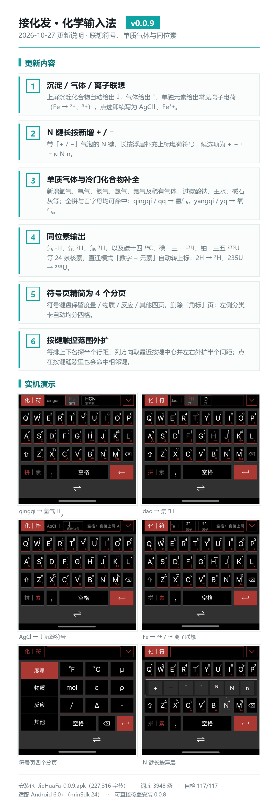
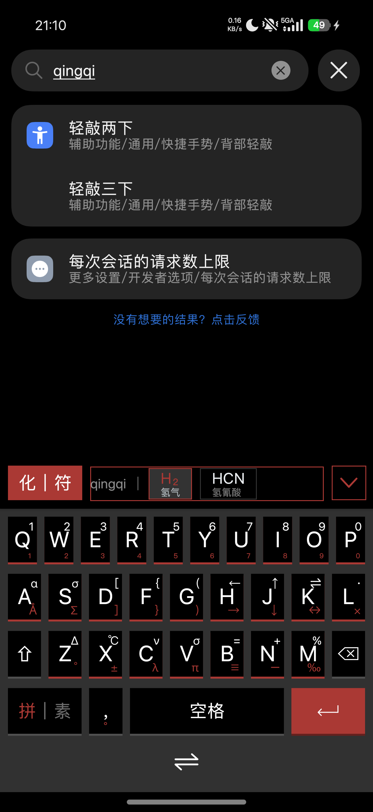
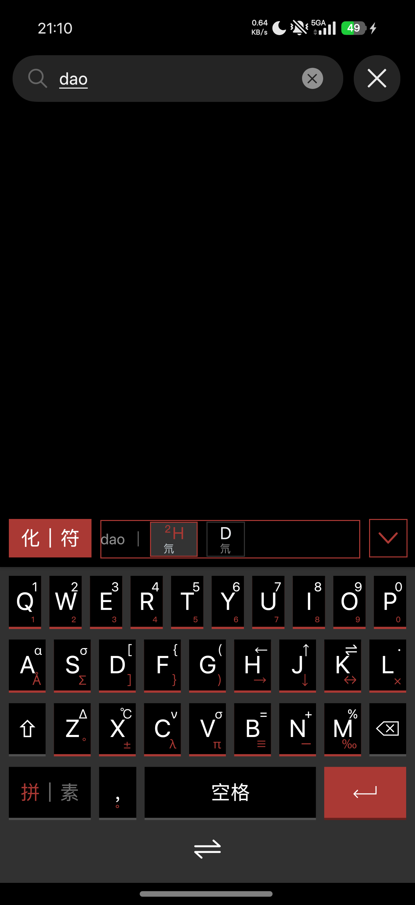
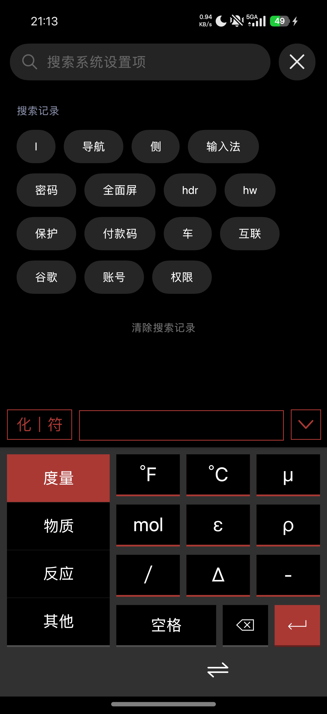

# 接化发 · 化学输入法

一款面向化学学习场景的 Android 输入法。用拼音直接打出化学式：自动上下标、沉淀/气体符号联想、离子与同位素输入，无需切换应用、无需复制粘贴。



## 功能特性

| 输入 | 结果 |
|---|---|
| `tong` / `tg` | 铜 `Cu`、碱式碳酸铜 `Cu₂(OH)₂CO₃` |
| `qq` / `qingqi` | 氢气 `H₂↑` |
| `pie` / `dao` / `chuan` | 氕 `¹H`、氘 `²H`、氚 `³H` |
| 直通模式 `Fe2O3` | `Fe₂O₃`（数字自动转下标） |
| 直通模式 `235U` | `²³⁵U`（数字 + 单元素自动转上标质量数） |

- **化学式自动排版**：支持全拼、拼音首字母与前缀匹配，四级候选排序，打出即带正确上下标
- **符号联想**：打出沉淀化合物联想 `↓`、气体联想 `↑`；输出单个元素后联想其常见离子（`Fe` → `Fe²⁺` / `Fe³⁺`）
- **同位素通用输入**：任意「数字 + 元素」自动转上标质量数，常用核素可直接用拼音打出
- **上下标键盘**：字母键上滑输入下标，长按弹出数字/上下标浮层，N 键长按可选 `⁺` / `⁻`
- **符号面板**：度量 / 物质 / 反应 / 其他 四个分页
- **词库 3948 条**：含 479 条多读音，覆盖冷门化合物与俗名（如过碳酸钠）
- **极简权限**：仅 `BIND_INPUT_METHOD`，无网络、无存储，不收集任何用户数据
- 纯 framework API 实现，零第三方依赖，兼容 Android 6.0+（minSdk 24）

## 截图

| 拼音输入氢气 | 同位素输入 | 符号面板 |
|---|---|---|
|  |  |  |

## 安装

1. 从 [Releases](../../releases) 下载最新 `JieHuaFa-<版本>.apk` 并安装
2. 打开应用，按引导在系统设置中启用「接化发」并切换为当前输入法
3. 在任意输入框中切换到该输入法即可使用

## 从源码构建（Windows）

构建链不依赖 Gradle：`aapt2 → javac → d8 → 打包 → zipalign → apksigner`。

前置要求：

- JDK 17（`javac` 可用）
- Android SDK：`platforms/android-34` + `build-tools/35.0.0`
- Python 3（`patch_manifest.py`、`zip_insert.py` 需要）

```powershell
cd source
# 先把 build.cmd 顶部的 SDK= / JDK= 改为本机路径
build.cmd
# 输出：source\out\JieHuaFa.apk
```

词库匹配自检（117 条用例）：

```powershell
python source/tools/test_matcher.py
```

> 签名密钥不随仓库分发。请用 `keytool` 自行生成 `source\keystore\debug.jks`，
> 或直接改动 `build.cmd` 中的 `KEYSTORE` 指向你自己的密钥。

## 仓库结构

```
source/
├── app/src/main/java/com/jhf/jiehuafa/   输入法源码（Java，键盘 UI 由 Canvas 手绘）
│   └── ime/                              JhfImeService / ChemKeyboardView / PinyinMatcher
├── app/src/main/assets/chem_dict.json    化学词库（名称 + 拼音 + 化学式）
├── tools/                                词库生成、匹配自检与 UI 回归脚本
├── build.cmd                             免 Gradle 一键构建脚本
└── keystore/                             签名密钥（本地生成，不入库）
```

## 许可证

本项目基于 [GNU 通用公共许可证第 3 版](LICENSE)（GPL-3.0）开源。

Copyright (C) 2026 哈潚

你可以依据自由软件基金会发布的 GPL-3.0 条款重新分发和/或修改本程序。
本程序分发时希望它有用，但不提供任何担保；详见 LICENSE 文件。

任何分发本程序或其衍生作品的行为，都必须同样以 GPL-3.0 开放源代码。
