# 接化发 · 化学输入法 1.0.0 使用文档

> **版本** 1.0.0　｜　**平台** Android 7.0 及以上
>
> **设计制作** 哈潚　｜　**出品** HAGO 工作室
>
> **许可** GPL-3.0 开源　｜　**运行** 完全离线

# 一、应用简介

接化发是一款面向化学学习与写作场景的 Android 输入法。它在常规拼音键盘的基础上，把化学写作里最常打的三类内容直接放到键面上：化学式候选、上下角标与反应箭头、以及可离线配平的化学方程式。

输入全程在本机完成，应用不申请网络权限，拼音匹配、词库与剪贴板历史都不会离开设备。

## 1.1 核心能力

- 化学式联想：输入物质中文名的拼音或首字母，候选栏直接给出化学式，例如输入 tansuan 得到 H₂CO₃ 与 CO₃²⁻。
- 符号随手可取：字母键的角标就是化学常用符号，点按输入主字符、上滑或长按取角标与变体。
- 反应式配平：切换到「自动模式」，依次放入反应物后点击「发生反应」，键盘直接给出配平好的方程式，确认即可上屏。
- 三种中文方案：普通模式下可选择全拼、双拼、九键，兼顾写作业与日常聊天。
- 布局可调：键盘支持内嵌与悬浮两种形态，四边尺寸可拖动调整并保存。
- 深浅主题：浅色、深色与跟随系统三态切换，深色采用纯黑底以适配 OLED 屏幕。

## 1.2 适用与不适用

如果你经常书写化学式、反应式、实验报告或化学笔记，本输入法能显著减少在符号面板之间来回切换的次数。如果只是日常聊天，系统自带输入法已经够用，不必额外安装。

## 1.3 一分钟验证

| 试一下 | 应得到 |
| --- | --- |
| 在化学键盘依次点 T、O、N、G | 候选栏出现 Cu、Cu₂(OH)₂CO₃、Cu²⁺ 等铜相关化学式 |
| 在 Q 键上向上滑 | 输入键面左下角的角标符号 ₁ |
| 长按 T 键 | 弹出 5 个形态气泡，按住滑到目标项松手即输出 |
| 输入 qq | 候选 H₂↑（气体自动补上箭头） |
| 自动模式放入「钠」和「水」，点发生反应 | 2 Na + 2 H₂O = 2 NaOH + H₂↑ |

# 二、安装与启用

## 2.1 安装

从项目 Releases 下载最新安装包 JieHuaFa-1.0.0.apk，点击安装。系统若提示「未知来源」，按提示允许本次安装即可。

## 2.2 启用输入法

- 打开「接化发」应用，按首页引导进入系统设置的输入法列表。
- 在列表中找到「接化发 · 化学输入法」并打开开关。
- 在任意输入框中长按，选择「输入法」，把当前输入法切换为接化发。

部分系统只列出已启用的输入法，若列表中没有出现接化发，可进入「设置 → 系统 → 语言与输入法 → 当前输入法」中选择「接化发 · 化学输入法」，选中即同时完成启用与切换。

## 2.3 回到原输入法

键盘工具条最右侧的「切换输入法」按钮会直接唤起系统输入法选择器，键盘不会收起，可随时切回其他输入法。

# 三、主界面导览

应用主界面用于查看版本信息、调整通用设置和试用键盘。整页自上而下分为三个分区：应用信息、通用、键盘试用输入框。

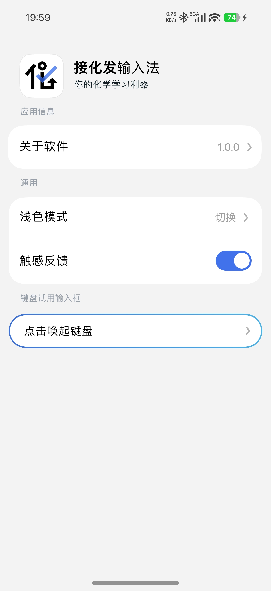

*主页（浅色）*

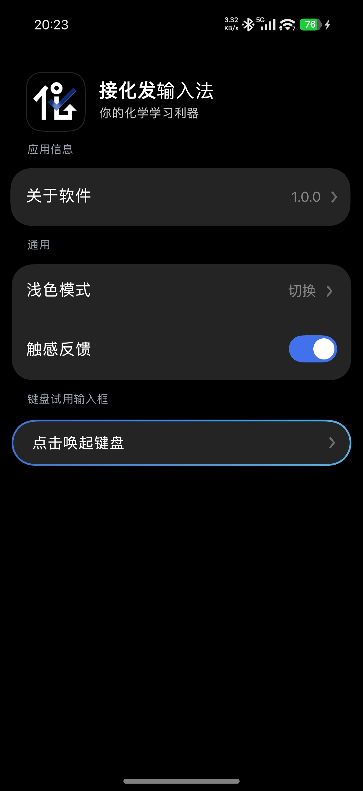

*主页（深色，纯黑底）*

## 3.1 应用信息

「关于软件」右侧显示当前版本号 1.0.0，点击进入关于页，可查看作者信息、加入交流群、打开应用文档，以及查看全部第三方许可。

## 3.2 通用

| 设置项 | 说明 |
| --- | --- |
| 浅色模式 | 三态循环切换：浅色 → 深色 → 跟随系统。当前状态显示在右侧。 |
| 触感反馈 | 开关。开启后按键、长按与调节操作会触发轻微振动。 |

## 3.3 键盘试用输入框

页面底部的输入框可直接点击唤起接化发键盘，用于在不离开应用的情况下试用键位与配平流程，避免在聊天软件里误发内容。

# 四、关于软件与许可

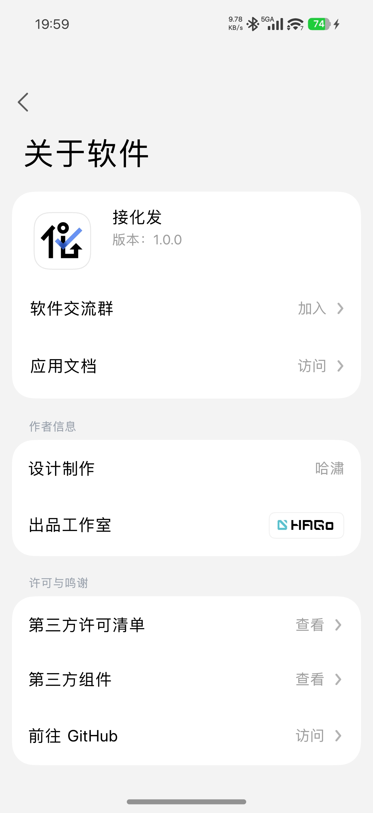

*关于软件（顶部信息区）*

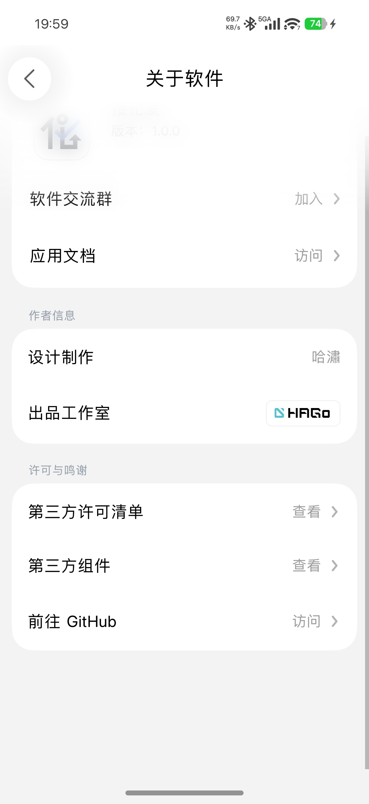

*向上滚动后出现吸顶栏*

关于页包含四块内容：

- 软件交流群：显示群号，点击「加入」可复制群号或跳转加群。
- 应用文档：点击「访问」打开本文档的在线版本。
- 作者信息：设计制作 哈潚，出品工作室 HAGO。
- 许可与鸣谢：第三方许可清单与第三方组件两个入口，以及「前往 GitHub」按钮。

页面向上滚动时，顶部会浮现固定的吸顶栏，左侧是应用图标与「关于软件」标题，便于随时确认当前位置并快速返回。

## 4.1 第三方许可清单

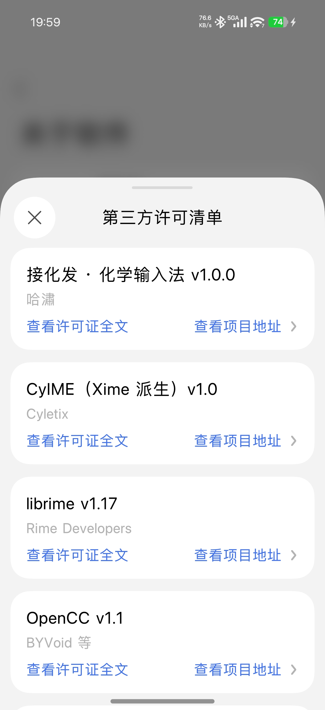

*半屏面板（可关闭）*

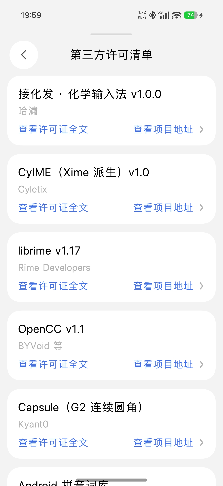

*展开全屏后完整浏览*

许可清单以半屏面板呈现，向上拖动可展开为全屏列表，条目包括接化发本体、CyIME、librime、OpenCC、Capsule 等组件，每条都标注了版本、作者、许可证类型与项目地址，点击条目可查看许可证全文。本应用整体以 GPL-3.0 分发，衍生关系与出处均在此页说明。

# 五、键盘总览

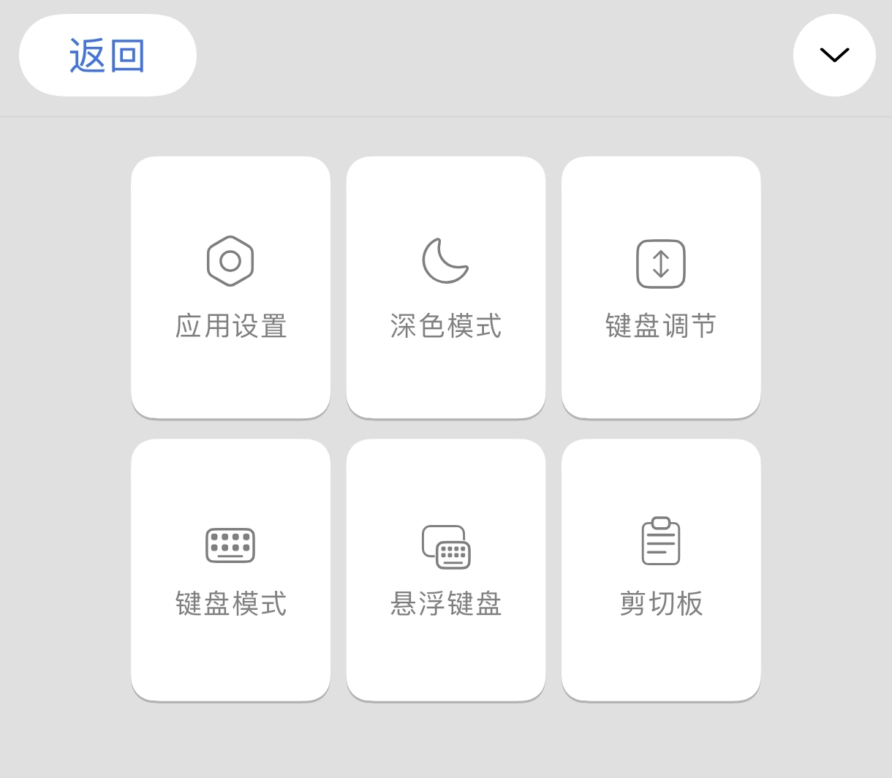

*键盘顶部的工具条：从左到右共 8 个按键*

| 位置 | 按键 | 作用 |
| --- | --- | --- |
| 1 | 品牌圆键 | 字母页点击回到化学键盘首页；长按进入符号页 |
| 2 | 键盘模式 | 弹出键盘类型菜单：化学输入 / 普通·全拼 / 普通·双拼 / 普通·九键 |
| 3 | 深浅切换 | 月亮与太阳图标互换，一键在浅色与深色间切换，选择会被记住 |
| 4 | 悬浮键盘 | 在内嵌键盘与可拖动的悬浮窗之间切换 |
| 5 | 键盘调节 | 进入尺寸编辑态，四边独立拖拽 |
| 6 | 剪切板 | 打开本地剪贴板历史面板 |
| 7 | 切换输入法 | 唤起系统输入法选择器，键盘不收起 |
| 8 | 收起 | 收起键盘 |

## 5.1 切换键盘类型

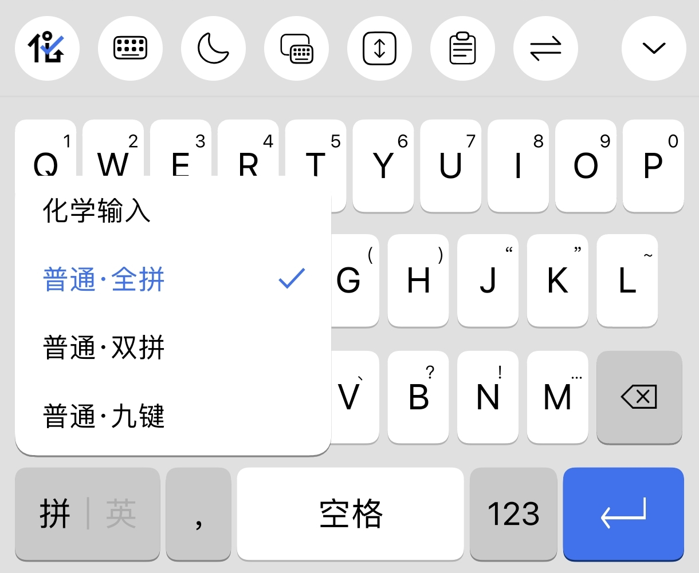

*点击工具条第 2 个按键弹出的键盘类型菜单*

菜单分为两组：「化学输入」与「普通」的三种方案。当前生效的选项右侧显示蓝色对勾，点击其他项立即切换，键盘会记住上次的选择。

## 5.2 拼音与直通：拼 / 素

化学键盘左下角的「拼 | 素」按钮控制输入方式。选中「拼」时，按键输入被当作拼音，候选栏给出对应的化学式；选中「素」时，按键直接上屏，适合手动拼写复杂式子。普通键盘的同一位置显示为「拼 | 英」，在中文拼音与英文直输之间切换。

# 六、化学键盘

## 6.1 键位与角标

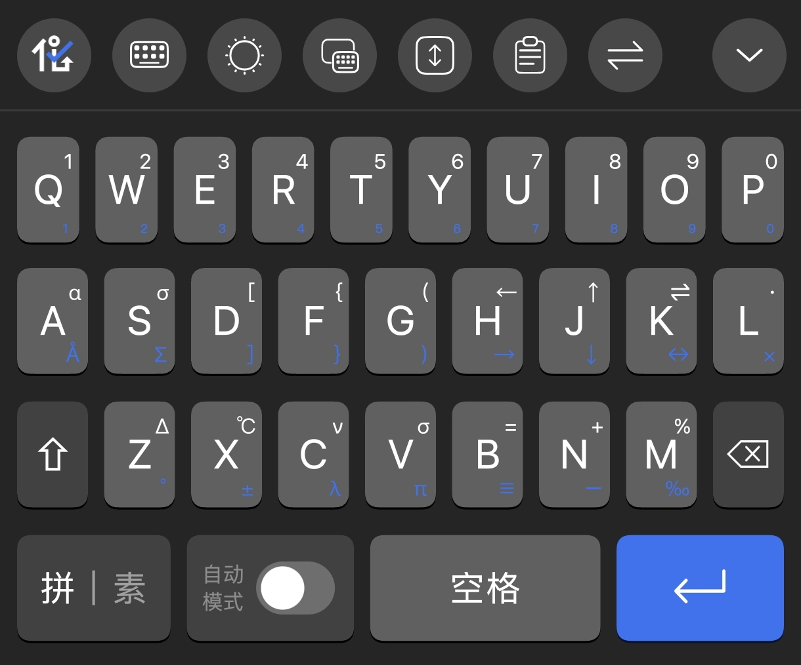

*化学键盘深色形态，键面角标与化学符号一览*

化学键盘的每个字母键都携带三层信息：中间是主字符，右上角是数字或常用小符号，左下角（部分键在右下角）是蓝色标注的化学符号。点按输入主字符，上滑输入角标符号，长按查看并选择全部变体。

| 按键 | 右上角标 | 化学符号（上滑/长按） |
| --- | --- | --- |
| Q W E R T Y U I O P | 1 2 3 4 5 6 7 8 9 0 | 对应的上标数字与下标数字 |
| A | α | Å（埃） |
| S | σ | Σ（求和） |
| D / F / G | [ / { / ( | ] / } / )（括号闭合） |
| H | ← | →（可逆箭头两端） |
| J | ↑ | ↓（升降符号） |
| K | ⇌ | ↔（可逆与双向箭头） |
| L | · | ×（乘号） |
| Z | Δ | °（度） |
| X | ℃ | ±（正负） |
| C | v | λ（波长） |
| V | σ | π（圆周率） |
| B | = | ≡（恒等） |
| N | + | −（正负离子） |
| M | % | ‰（千分号） |

## 6.2 长按气泡

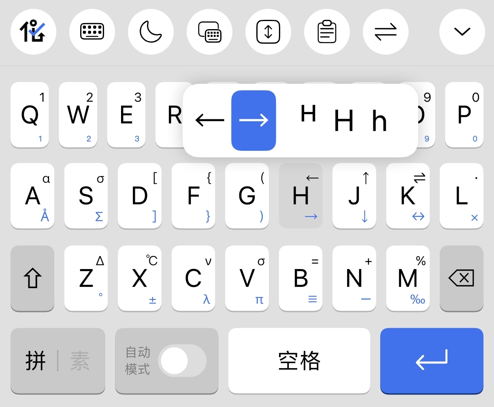

*长按字母键弹出气泡，当前项高亮，滑动选择后松手输出*

长按任意字母键会弹出 5 个形态的气泡，气泡内按由上到下的顺序排列，手指滑到某一项时该项变为蓝色高亮，松手即输出该项。若不想输入任何内容，滑出气泡区域后松手即可取消。

## 6.3 手动模式

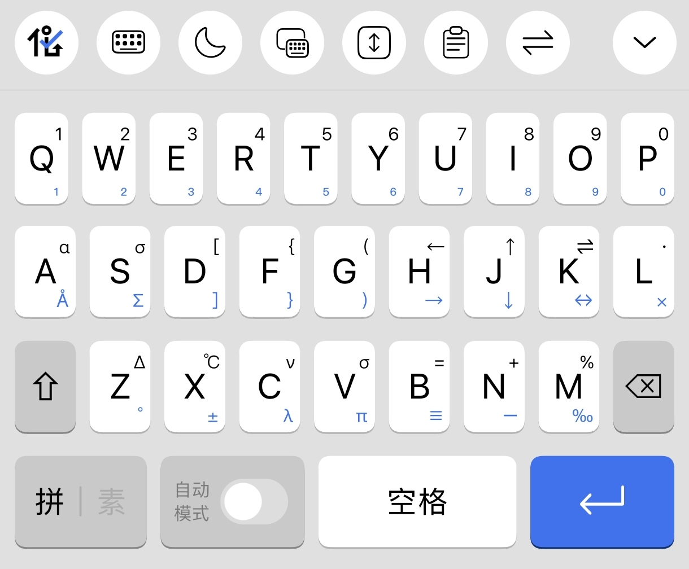

*手动模式：稳定的字母与符号键面*

手动模式保持字母键面不变，底部显示「自动模式」开关（关闭状态）、空格与回车。适合逐字拼写化学式，例如输入 CuSO4 时，候选栏会给出规范化写法 CuSO₄；输入 235U 会整理为 ²³⁵U。

## 6.4 自动模式与反应式配平

打开「自动模式」后，键盘底部原来的空格位置变为蓝色的「发生反应」按钮，键盘上方的输入区变为反应物构建区。整个流程分四步：

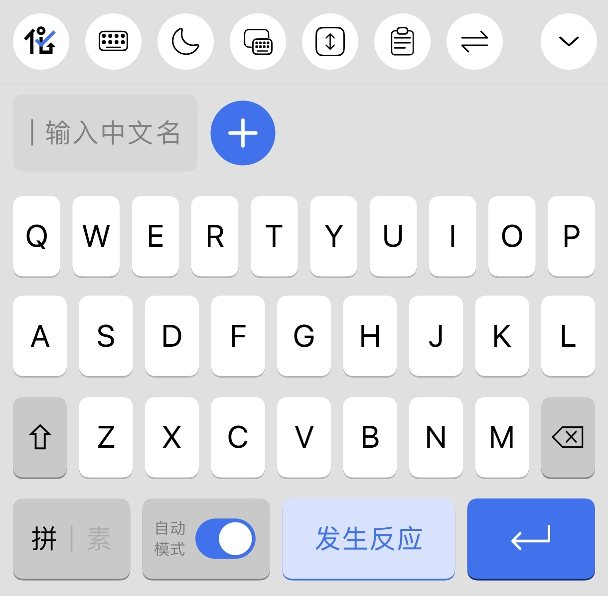

*自动模式初始态：输入区只有占位提示与添加按钮*

第一步，点击输入区右侧的「+」，在提示「输入中文名」处输入物质名称或拼音。候选栏会同时给出多个可能的物质及其化学式。

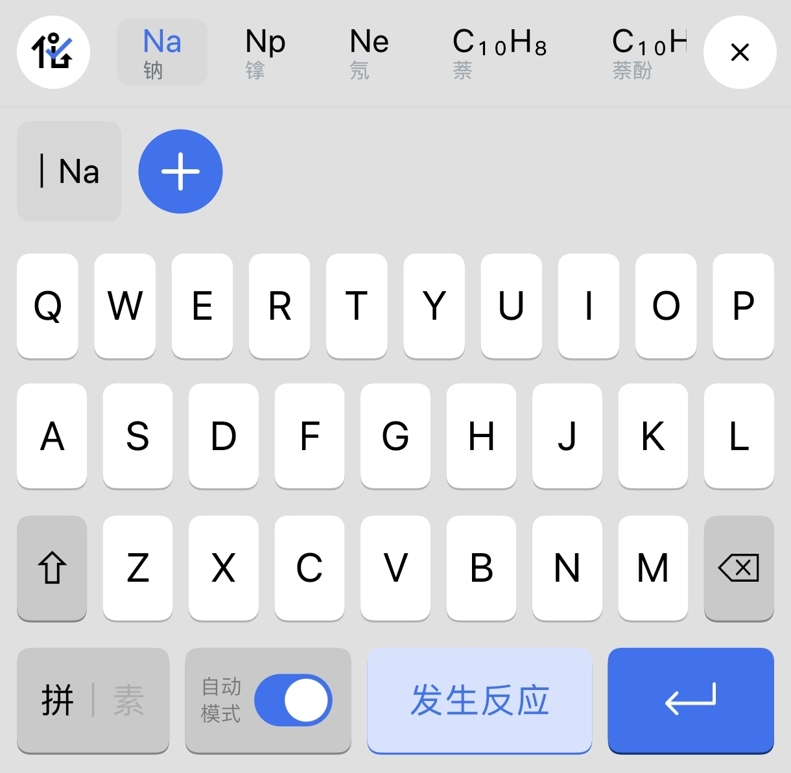

*输入第一个反应物「钠」，候选中给出 Na、Np、Ne 等*

第二步，从候选栏选择正确的化学式，它会被确认为一个反应物芯片。候选栏右端的 × 可以关闭候选列表；芯片左侧的 × 可以移除该反应物。

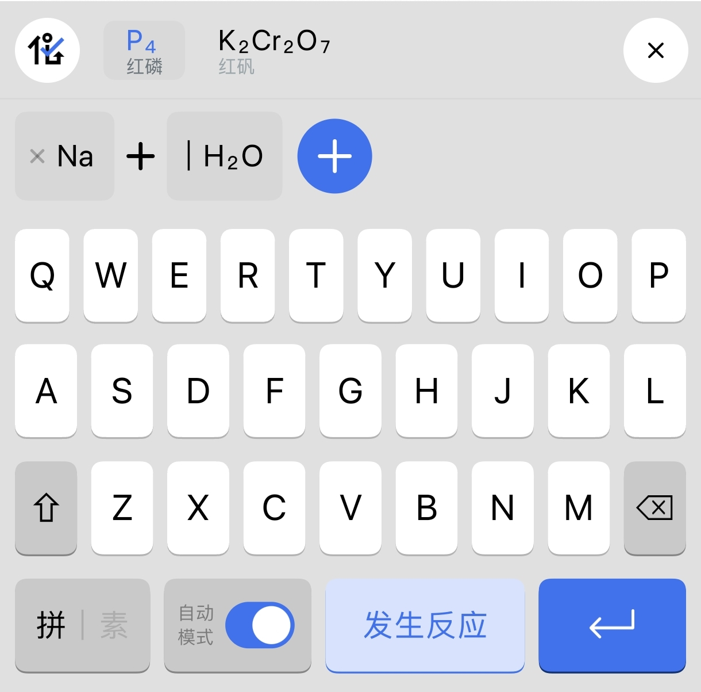

*继续添加第二个反应物「水」，生成 H₂O 芯片*

第三步，重复添加直至反应物齐全，点击「发生反应」。键盘会先尝试完整组合精确匹配；若含离子，则剔除硫酸根、钠离子、硝酸根等旁观离子后，用剩余离子组合再查，输出净离子方程式。

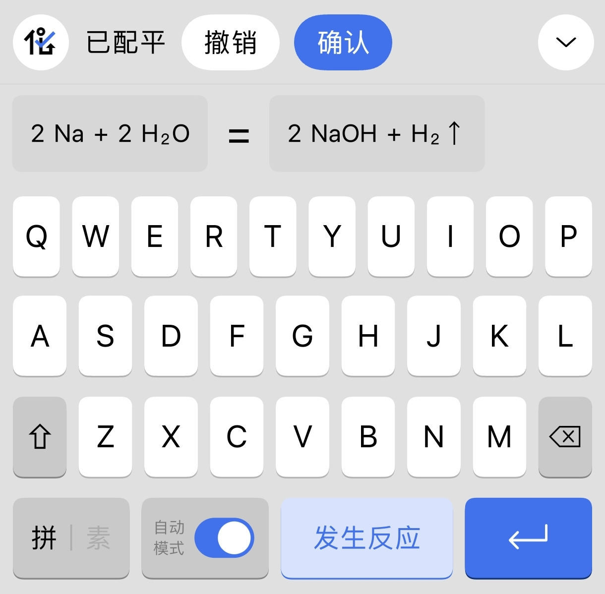

*配平完成：顶部出现「已配平」与撤销/确认，下方给出完整方程式*

第四步，确认结果。配平成功后输入区顶部显示「已配平」，并出现「撤销」与「确认」两个按钮：点「确认」把方程式上屏；点「撤销」回到反应物编辑状态。方程式按「反应物 = 生成物」排列，气体与沉淀会自动补上 ↑ ↓ 标记。

## 6.5 智能联想

| 输入情形 | 自动增加的候选 |
| --- | --- |
| 化合物为沉淀 | 追加 ↓ 标记 |
| 化合物为气体 | 追加 ↑ 标记 |
| 输出单个元素 | 追加该元素常见离子，如 Fe → Fe²⁺、Fe³⁺ |
| 输入 qq 等常见缩写 | 给出对应物质与状态符号 |

# 七、普通中文键盘

普通模式面向日常输入，提供全拼、双拼、九键三种方案，切换入口在工具条第 2 个按键的菜单里。

## 7.1 全拼

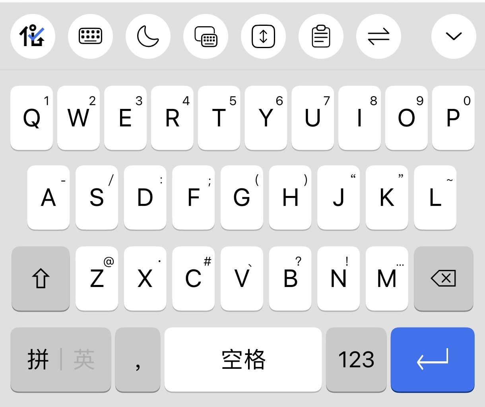

*普通·全拼：26 键全键盘，键角带标点与符号*

全拼方案采用标准 QWERTY 布局，键面右上角标注常用标点。底部为「拼 | 英」切换、空格、123 数字页与回车。适合熟悉电脑键盘的用户。

## 7.2 九键

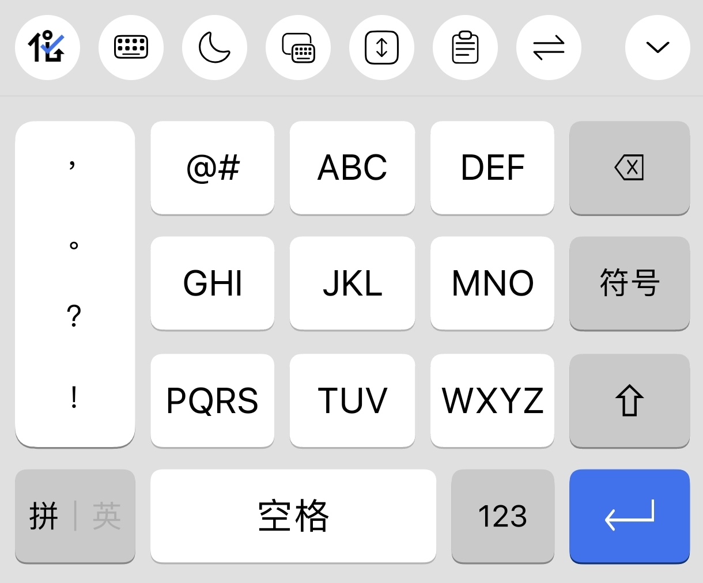

*普通·九键：左侧标点列，右侧退格与上档*

九键方案把 26 个字母归入 8 个数字键，左侧一列是常用标点，右侧是退格、符号与上档键。单手握持时输入效率更高。

## 7.3 双拼

双拼方案在 26 键布局上使用双拼编码，每个音节的声母与韵母各占一键，适合已经习惯双拼的用户。

## 7.4 数字页

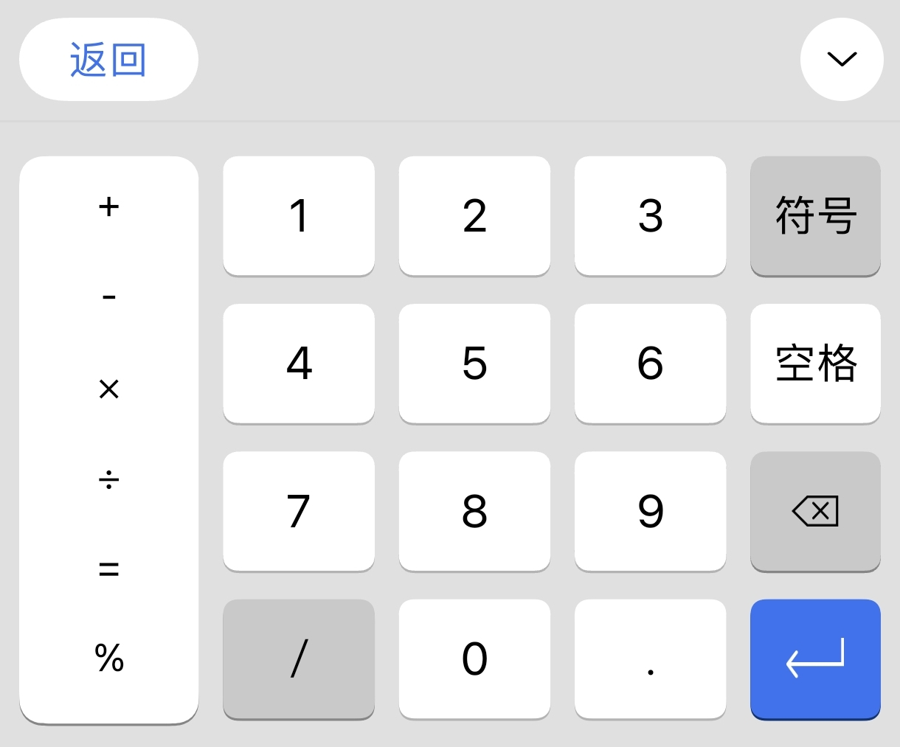

*数字页：左侧运算符，主区数字与小键盘符号*

点击底部 123 进入数字页。左列是 + − × ÷ = % 六个运算符，主区为 1 到 9、0、小数点和斜杠，右侧是符号页、空格与退格。写方程式时的系数、下标数字都可以在这一页快速输入。

## 7.5 符号页

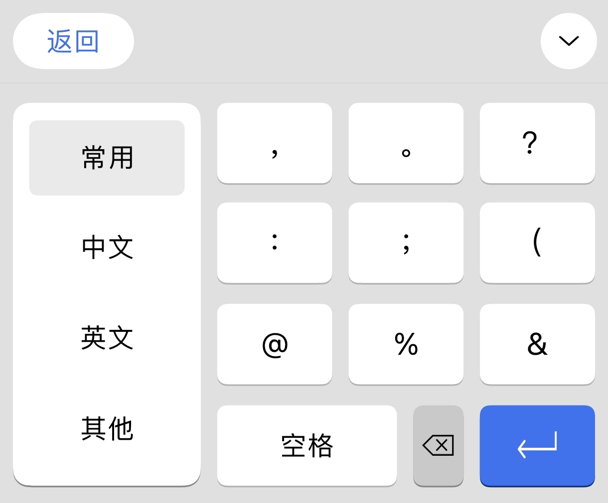

*符号页：常用 / 中文 / 英文 / 其他四类*

符号页顶部是分类栏，点击切换右侧网格。四个分类分别是常用、中文、英文、其他。写反应式时常用组合是：在字母页输入元素符号，到符号页取 ⇌ 或 →，再回到数字页补上下标。例如水的电离可写成 H₂O ⇌ H⁺ + OH⁻。

# 八、键盘布局与调节

## 8.1 悬浮键盘

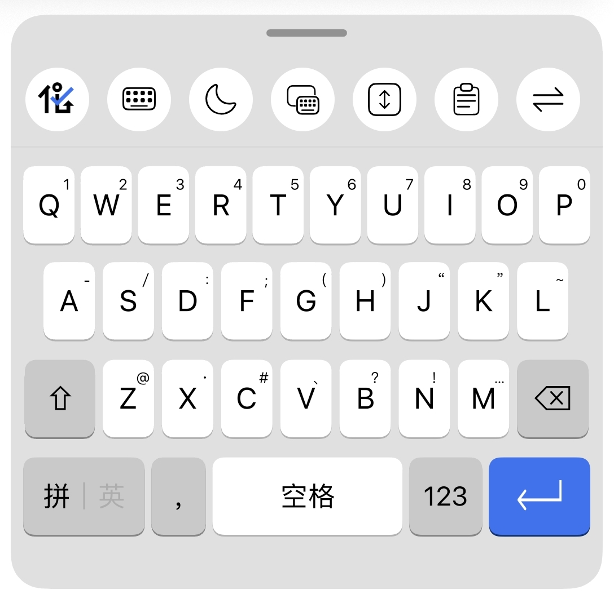

*悬浮窗形态：顶部横条可拖动，圆角卡片边缘*

点击工具条第 4 个按键可在内嵌键盘与悬浮窗之间切换。悬浮窗为圆角卡片，顶部有一条拖动横条，按住可把键盘移动到屏幕任意位置，适合一边看资料一边输入。悬浮状态下工具条省略收起按钮，其余按键保持不变。

## 8.2 键盘调节

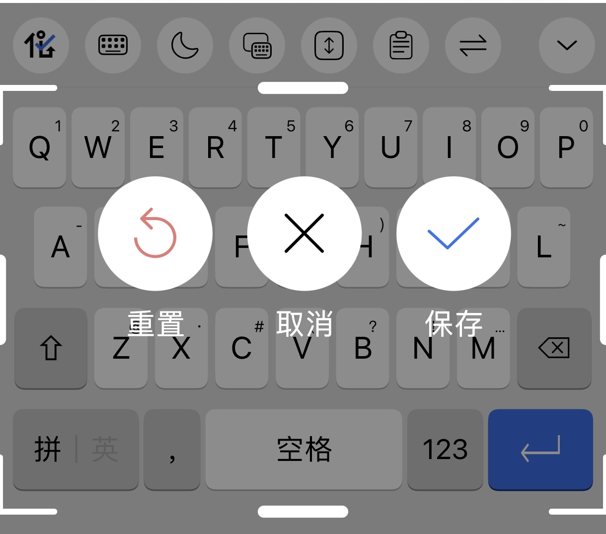

*调节态：四边出现白色拖拽条，中央是重置 / 取消 / 保存*

点击工具条第 5 个按键进入调节态。键盘四周出现白色拖拽条，分别控制上、下、左、右边界，拖动时键盘实时变形。中央三个圆形按钮分别是：

| 按钮 | 作用 |
| --- | --- |
| 重置（红色回环） | 恢复到默认键盘尺寸 |
| 取消（叉号） | 放弃本次调整并退出调节态 |
| 保存（对勾） | 保存当前尺寸，退出后再次唤起键盘仍然生效 |

# 九、剪切板

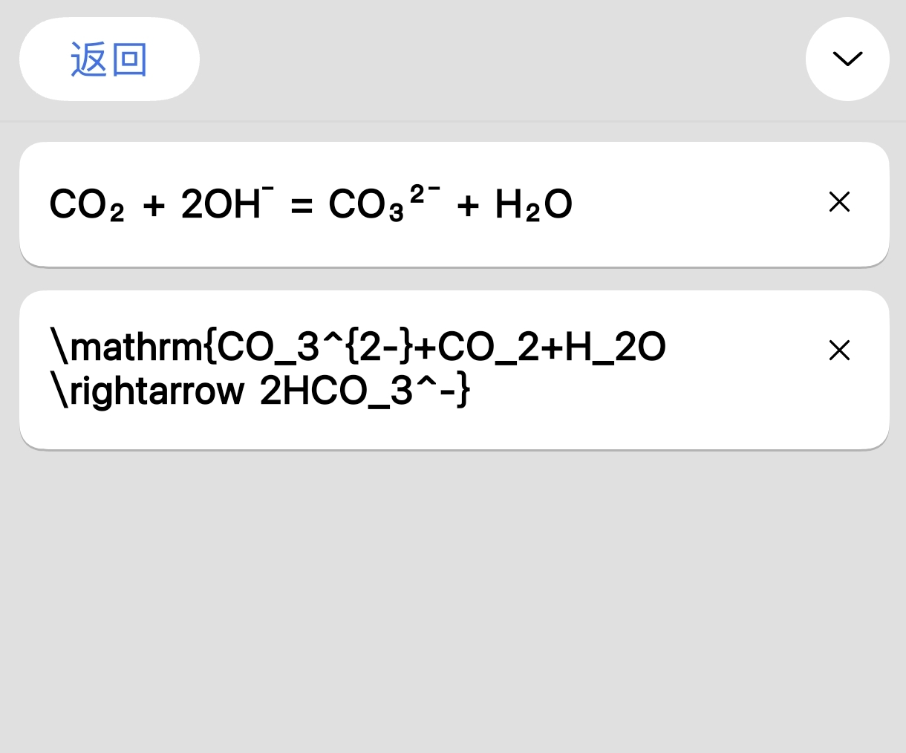

*剪贴板历史：卡片列表，每条可单独删除*

点击工具条第 6 个按键打开剪贴板面板，面板为全屏列表，顶部「返回」关闭。历史记录按时间倒序排列，每张卡片显示一条内容，右侧的 × 可删除该条。点选卡片即把内容上屏。

复制过的化学式会同时保留可直接阅读的写法与 LaTeX 源码（例如 \mathrm{CO_3^{2-}+CO_2+H_2O \rightarrow 2HCO_3^-}），在需要粘贴到支持公式的编辑器时可以直接取用源码。历史记录只保存在本机，最多保留 50 条，不会上传。

# 十、主题与外观

主题有三个状态：浅色、深色、跟随系统。入口有两处，效果一致：

- 应用主页「通用 → 浅色模式」，点击三态循环。
- 键盘工具条第 3 个按键，月亮与太阳图标互换，一键切换。

深色模式采用纯黑底与深灰键面，在 OLED 屏幕上更省电，夜间书写时也不刺眼。主题选择会被记住，下次唤出键盘保持相同外观。

# 十一、设置与数据

| 项目 | 说明 |
| --- | --- |
| 词库 | 化学词库（物质名称、拼音、化学式）、配平反应库与离子反应库随安装包内置，离线可用。 |
| 中文词库 | 普通模式使用内置拼音词库与 Rime 中文词库，约 40 MB，安装后无需联网下载。 |
| 剪贴板历史 | 仅本机 JSON 存储，最多 50 条，可在面板内逐条删除。 |
| 网络权限 | 未申请。应用不具备联网能力，输入内容不会离开设备。 |
| 权限 | 仅振动（触感反馈）与输入法绑定声明。 |

# 十二、常见问题

| 问题 | 处理方法 |
| --- | --- |
| 已安装但输入框调不出接化发 | 先在系统设置中启用，再到「当前输入法 / 默认输入法」中选择接化发。 |
| 长时间不用后首次唤起较慢 | 部分厂商系统会限制输入法后台运行，请在电池管理中允许「后台运行」与「自启动」。 |
| 找不到某个符号 | 先看符号页的四个分类；字母键的角标可直接上滑输入，长按可查看全部变体。 |
| 输入内容会被上传吗 | 不会。拼音匹配、词库与剪贴板全部在本机完成，应用无网络权限。 |
| 输入了两个反应物却没配平 | 检查自动模式是否开启、反应物芯片是否已从候选栏确认；含离子时会先尝试净离子式。 |
| 键盘太大或太小 | 用工具条的「键盘调节」拖动四边，点「保存」即可持久生效。 |
| 横向使用时键盘没有铺满 | 当前版本保持内嵌键盘，这是既定行为。 |
| 换手机后如何迁移 | 词库与设置随应用安装内置，剪贴板历史不迁移，避免旧数据泄露。 |
| 如何使用公式源码 | 在剪贴板中找到该条记录，复制其 LaTeX 源码粘贴到支持公式的编辑器。 |
| 是否需要联网更新词库 | 当前版本不联网，词库随新版本安装包更新。 |

# 十三、版本与许可

| 项目 | 信息 |
| --- | --- |
| 版本号 | 1.0.0（versionCode 20） |
| 包名 | com.jhf.jiehuafa |
| 系统要求 | Android 7.0 及以上（minSdk 24），原生库仅提供 arm64-v8a |
| 界面设计 | 哈潚 |
| 出品 | HAGO 工作室 |
| 开源许可 | GNU 通用公共许可证第 3 版（GPL-3.0） |
| 项目地址 | GitHub：uHaDawn/JHF_ChemistryInputMethod |

本应用基于 CyIME（GPL-3.0，上游为 Xime）的 Rime 内核与 T9 能力二次开发，com.kingzcheung.xime.rime 包下的 JNI 封装保留了上游许可与出处说明。librime、OpenCC、Capsule、Boost、ONNX Runtime、Android 拼音词库、rime-ice 中文词库等第三方组件的许可证全文，可在应用内「关于 → 许可与鸣谢 → 第三方许可清单」逐条查看。

任何分发本应用或其衍生作品的行为，都必须同样以 GPL-3.0 开放源代码。
